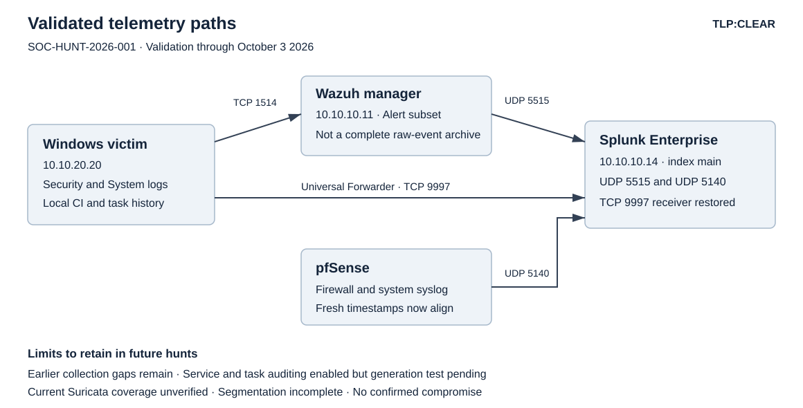

# Volt Typhoon informed SOC home lab threat hunt technical report

**TLP:CLEAR**

Case ID: SOC-HUNT-2026-001  
Version: 1.1  
Report date: October 3, 2026  
Evidence owner and operator: lab owner, identified in this chat as jpigg  
Analysis: collaborative review of user-supplied commands, screenshots, text, and CSV exports  
Audience: SOC analysts, incident responders, and lab administrators  
Disposition: hunt pass complete with follow-up actions; no confirmed compromise

## Executive Summary

The hunt examined whether unauthorized use of legitimate administration tools, accounts, and persistence mechanisms was present in the SOC home lab, using behavior described in public Volt Typhoon guidance. No confirmed compromise was identified in the reviewed evidence, so the hypothesis was not supported; it was not conclusively disproved because earlier activity was incompletely recorded. The observed activity was consistent with recognized user actions, security-agent checks, and software maintenance, with one Defender validation issue requiring operational follow-up. The investigation repaired missing log delivery and incorrect firewall timestamps, enabled additional auditing, and disabled a broad firewall rule that overrode more specific rules. The remaining priorities are to finish network segmentation, validate the new auditing, and improve historical evidence coverage before treating future empty searches as assurance.

## Methodology and Scope

### Objective and intelligence

Hypothesis H1: unauthorized actors may use valid accounts and built-in administration tools to perform discovery, establish persistence, or access credentials while blending into normal administration. Public CISA advisory AA24-038A informed the behaviors selected for review. That advisory describes living-off-the-land behavior and use of valid accounts; it does not make the presence of `net.exe`, PowerShell, or other tools an actor-specific indicator. This home lab is not asserted to be a Volt Typhoon target or a critical-infrastructure environment. [CISA AA24-038A](https://www.cisa.gov/sites/default/files/2024-03/aa24-038a_csa_prc_state_sponsored_actors_compromise_us_critical_infrastructure_3.pdf)

Hypothesis H2: the lab's telemetry is sufficient to observe and distinguish those behaviors. H2 was initially disproved for several sources: process auditing was disabled, Splunk was unavailable for earlier events, the TCP receiver was absent, firewall pass logging was ineffective on the intended rule, and service/task auditing was disabled. The fixes improved current visibility, but end-to-end service/task event generation remains pending validation.

### Time periods

| Period | Coverage and qualification |
| --- | --- |
| September 24–25, 2026 | Initial endpoint hunt, process-audit enablement, Wazuh/Splunk correlation, local persistence review, firewall validation and remediation |
| September 26 and October 3, 2026 | Splunk TCP receiver diagnosis and restoration, direct Security event review, Defender analysis, service/task auditing and task-history review |
| September 19–20, 2026 | Older service-installation and logon records reviewed as supporting context, not continuous coverage |
| September 25 20:39:32–21:09:31 MDT | Exact firewall CSV window: 7,846 logged records; contains events before and after timestamp repair and rule transition |
| October 3 01:54:30.192–02:20:59.161 MDT | Exact process export: 626 records; a 24-hour search returned this shorter observed span |
| October 3 01:54:32.609–02:25:15.208 MDT | Exact logon export: 19 records |
| September 27 17:23:12–October 3 02:36:48 | Task-history export within a rolling seven-day query: 212 records; no continuous operation is assumed |

Unless marked otherwise, times are displayed in America/Denver, UTC−06:00 for these dates. Windows XML timestamps ending in `Z` are UTC; `07:58:47Z` corresponds to `01:58:47 MDT`. pfSense initially used fixed MST, and its long-running filter logger retained timestamps one hour behind the corrected clock until reboot. Old embedded firewall timestamps must not be interpreted as MDT without that qualification. Splunk `_time` and `_indextime` are different concepts: the former is event time, the latter index receipt time. Numeric export filenames are evidence identifiers, not a basis for inferring execution time.

### Systems and data sources

| System | Address or identity | Role and analysis coverage |
| --- | --- | --- |
| Windows victim | `10.10.20.20`; `soc-vict-win10.sochomelab.local`; Wazuh agent 001 | Primary endpoint; Security, System, Code Integrity, Task Scheduler, processes, services, tasks, signatures, live TCP connections |
| pfSense CE 2.8.1 | Management `10.10.10.5`; Corporate `10.10.20.5`; attacker network `10.10.30.5`; WAN DHCP observed `10.10.40.101` | Rules, active ruleset, remote syslog, local firewall logs, time configuration |
| Wazuh 4.14.7 | `10.10.10.11`; `soc-xdr-wazuh` | Alert JSON and default syslog forwarding; source of Security-alert subset |
| Splunk Enterprise 10.2 | `10.10.10.14`; `soc-siem-splunk` | Search and exports; UDP 5515 Wazuh, UDP 5140 pfSense, TCP 9997 direct forwarder |
| Windows Universal Forwarder | Service `SplunkForwarder`; process `splunkd` | Direct Windows event and performance-metric delivery; TCP 8089 management and TCP 9997 receiving |
| AD VM | `10.10.20.10` | Architecture context only; domain-controller logs and credential stores not analyzed |
| Kali | `10.10.30.10` | Architecture context only; no attacker execution or adversary emulation performed |
| ELK, Shuffle, OpenVAS | `10.10.10.10`, `.13`, `.12` | Existing lab context; not additional validated hunt data sources |
| Suricata | Prior lab validation exists | Current hunt-period alert/flow coverage not revalidated; no claim of full network inspection |

Lab interfaces: `em1` management/VMnet1, `em2` Corporate/VMnet2, `em3` attacker/VMnet3, and `em0` WAN/VMnet8. Host resources require running a subset of lab VMs. VM uptime and source availability must be treated as intermittent unless verified.

### Evidence and analytic method

The operator executed commands on the VMs and supplied outputs. Analysis compared local Windows records, Wazuh alerts, Splunk exports, firewall logs, signatures, and user recognition of activity. Benign commands were generated to test process visibility and firewall logging. Investigation correlated record IDs, logon IDs, process names and parents, command arguments, addresses, ports, rule tracker IDs, and Code Integrity ActivityIDs. File signatures were checked on the endpoint; no memory acquisition, disk imaging, malware detonation, packet-payload analysis, or full binary provenance assessment was performed.

The [command log](command-query-log.md) distinguishes commands visible in the record from reconstructed repeatable procedures. Commands reconstructed from described work are not represented as exact historical keystrokes. Failed copy/paste attempts and incorrect analytic suggestions are retained as lessons and do not count as completed checks. CSV attachments were parsed from the complete files; terminal-output truncation did not define the analytic dataset. Original available evidence is copied and checksummed in the [evidence register](evidence-register.md).

### Confidence model

**High** means directly supported by captured output and, where applicable, an independent corroborating source. **Moderate** means a supported interpretation with unresolved context or incomplete historic coverage. **Low** means a candidate or architectural inference requiring further evidence. Confidence applies to the stated finding, not automatically to maliciousness. A valid signature confirms the current verification result, not absence of all malicious use. A successful TCP connection proves connectivity, not event ingestion. A process-name match identifies a candidate, not a compromise.

## Key Findings and IOCs

### Findings register

| ID | Finding and affected system | Confidence | Status and implication | ATT&CK relevance |
| --- | --- | --- | --- | --- |
| F01 | No confirmed malicious activity in reviewed victim evidence | Moderate, bounded | H1 not supported; incomplete history prevents definitive disproof | Coverage across execution, discovery, valid accounts and persistence |
| F02 | Process auditing initially absent; command-line capture enabled September 24 | High | Remediated for current observation; past process events not recovered | T1059.001, T1059.003 and discovery techniques |
| F03 | Splunk unavailable for earlier Wazuh events; tasklist record 43513 unlocated in Splunk | High for observed gap; low for loss mechanism | Historical availability gap and one unresolved delivery candidate; UDP loss not proven | Monitoring limitation, not an observed ATT&CK action |
| F04 | Quick floating IPv4 any-to-any rule handled traffic before interface rules | High | Disabled; new connection matched Corporate tracker 1786792812 | Configuration exposure; not evidence of adversarial firewall modification |
| F05 | Firewall embedded timestamps one hour behind MDT | High | Reboot replaced filterlog PID 5400 with 52199; fresh timestamps align | Timeline reliability issue |
| F06 | TCP 9997 receiver absent; forwarder repeatedly sent SYNs | High | Receiver enabled, listener and established connection verified, direct events received | Collection-health issue; not command-and-control evidence |
| F07 | DefenderSessionHelper protected-process signature validation failed | High for correlation and error; moderate for operational classification | Valid current Microsoft signature; PPL requirement mismatch; root cause/recurrence unresolved | Integrity candidate; no technique asserted |
| F08 | Latest local service-installation query returned no entries; task history showed maintenance-pattern updates | Moderate | No confirmed persistence in reviewed records; historical task actions not captured | T1543.003 and T1053.005 hunt coverage |
| F09 | Service/task Security auditing disabled | High | Success auditing enabled and verified; event generation/delivery test pending | T1543.003 and T1053.005 visibility |
| F10 | Local anonymous network logon lacked source context | High for event; low for explanation | Earlier type 3 session remains unexplained; no correlated malicious activity established | T1078/T1021 coverage only, not attribution |
| F11 | Administrator OneDrive task lacks returned profile/signature evidence | High for unverified state | Possibly stale; untouched; task ownership/action verification pending | T1053.005 candidate review |
| F12 | Public destinations and full inter-network segmentation remain unverified | High for limitation | Prioritize process/DNS correlation and restricted access plan | T1071.001/T1090.001 candidates; no C2/proxy abuse confirmed |

### Indicator and observable register

**No confirmed malicious IOC was established.** The following are evidence pivots, lab identities, test destinations, or unresolved observables. They must not be promoted to blocklists merely because they appear in this report.

| Observable | Affected system or context | Classification and confidence | ATT&CK context |
| --- | --- | --- | --- |
| `soc-vict-win10.sochomelab.local`, `10.10.20.20` | Victim endpoint | Lab identity, high | Scope only |
| `10.10.10.14:9997` and `:8089` | Victim → Splunk | Known telemetry destination, high; current owner `splunkd` PID 3596 | No malicious technique asserted |
| `10.10.10.11:1514` | Victim → Wazuh | Known agent destination, high | Scope only |
| `10.10.20.5:53` | Victim DNS | Known gateway resolver, high | DNS visibility pivot |
| `1.1.1.1:80/443`, `1.0.0.1:80/443` | Operator tests | Benign test destinations, high | Validation only |
| `52.123.248.83:443` | Live connection owned by Defender core service | Provisionally expected process context, moderate; payload/hostname not verified | T1071.001 coverage only |
| `20.59.87.225:443` | Live `svchost` PID 3552 mapped to WpnService | Provisionally expected process context, moderate; destination purpose not independently proved | T1071.001 coverage only |
| Public destinations in firewall table below | Victim HTTP/HTTPS | Unclassified, low confidence of maliciousness; no ownership/reputation conclusion | T1071.001 candidate coverage |
| `DefenderSessionHelper.exe` under Defender platform 4.18.26080.4-0 | Windows victim | Microsoft signature currently valid, high; PPL verification error 12, high | Integrity investigation only |
| `44FDDDE59B4233F7AF8114285A028B36CF585754FF794C834346E7AAAF56740E` | Code Integrity 3089 image-hash field | Investigative hash from event, high provenance to supplied XML; not independently computed whole-file SHA-256, not malicious IOC | Integrity pivot only |
| `0x7a169`, record 42807 | September 24 seclabadmin local type 2 session | Expected interactive session context, high | T1078 coverage only |
| `0x2b3bc`, record 42761 | Earlier ANONYMOUS LOGON type 3 | Unexplained local record, high; origin and maliciousness unknown | T1078/T1021 candidate coverage |
| `0x1B0AC16` and `0x1B0AB73` | October 3 seclabadmin logon pair | Operator-confirmed local sign-in, high | T1078 coverage only |
| Tracker `1786962198` | pfSense floating rule | Confirmed broad allow rule, high; disabled | Configuration finding |

Certificate TBS hashes from 3089 identify signing certificates, not file hashes or malware IOCs. They are preserved in the XML evidence. No malicious domain or whole-file malware hash was validated.

### ATT&CK coverage and interpretation

Mappings describe what the hunt examined, not a detected intrusion chain. Relevant technique definitions are linked in the references.

| Phase | Techniques used to organize the hunt | Evidence and disposition |
| --- | --- | --- |
| Initial access and valid accounts | T1078 Valid Accounts; T1021.001 Remote Desktop Protocol | Local 4624/4648 review; no type 10 in reviewed exports; entry method not established |
| Execution | T1059.001 PowerShell; T1059.003 Windows Command Shell | Command/parent review; Wazuh assessment commands and VMware resume script provide expected context |
| Discovery | T1033 System Owner/User Discovery; T1082 System Information Discovery; T1016 System Network Configuration Discovery; T1057 Process Discovery; T1087.001 Local Account | Explicit benign commands validated visibility; no actor attribution from executable names |
| Persistence and privilege | T1053.005 Scheduled Task; T1543.003 Windows Service | Current task/service review, history, audit-policy checks; no confirmed malicious persistence |
| Credential access | T1003.003 NTDS; T1003.001 LSASS Memory | Tool candidates examined; no credential dumping established; AD/DC credential stores not assessed |
| Defense evasion | T1070.001 Clear Windows Event Logs; T1112 Modify Registry; T1218.011 Rundll32 | Query versus modification and manifest registration versus clearing distinguished; no malicious action established |
| Lateral movement and proxying | T1021 Remote Services; T1090.001 Internal Proxy | Network logons and `netsh interface portproxy show all`; no entries returned; historical configuration unknown |
| Command and control or actions on objectives | T1071.001 Web Protocols | Public HTTP/HTTPS remains unclassified; no C2, exfiltration, collection, impact, or disruption demonstrated |

## Detailed Analysis

### Phase 1 Visibility baseline and process validation

WazuhSvc was running, but Windows Audit Process Creation initially showed No Auditing and the command-line audit registry value was absent. Success auditing and `ProcessCreationIncludeCmdLine_Enabled=1` were enabled. A benign `cmd.exe` marker produced local Security 4688 record 42962 at September 24 19:30:42; Wazuh received it at 19:30:45.988−0600 under rule 67027, level 3. This verified local generation and manager detection, not complete forwarding history.

The original Splunk search did not locate the first marker. Subsequent tests labeled TEST_02 returned records 43496 and 43497 at 20:36:03 and 20:36:08. These are distinct process executions, not evidence of duplicate ingestion. Manager alert forwarding had no restrictive level filter, and a packet capture at the receiver showed datagrams. No filter change was needed merely because no explicit minimum level was present. Wazuh alerts are a subset of Windows event records, not a raw-event archive. [Wazuh syslog output](https://documentation.wazuh.com/current/user-manual/reference/ossec-conf/syslog-output.html)

The discovery test generated `whoami /all`, `hostname`, `ipconfig /all`, `net user`, and `tasklist`. Splunk returned records 43509, 43511, 43512, 43514 and 43515; `net1.exe` was a child of `net.exe`, while the other visible commands had PowerShell parents. Tasklist record 43513 existed locally at 20:40:44 and in Wazuh at 20:40:47.068 but was not located in Splunk. Repeated filtered tasklist executions arrived as records 43538 and 43539. The missing original record remains a collection anomaly; the investigation did not prove UDP truncation, packet loss, or an attacker action.

Process searches initially used a candidate-name list without extracting `process_name` after a login-query edit. The complete 4688 extraction and basename normalization corrected that query. A zero from the incomplete query was not a meaningful negative finding. Benign higher-risk-tool checks generated `netsh interface portproxy show all` (record 43612, 21:10:45) and `sc query WazuhSvc` (43613, 21:11:14). Both matched seclabadmin with PowerShell parents. Portproxy returned no entries in current configuration; the service query checked rather than changed Wazuh.

### Phase 2 Session and logon review

Local record 42807 identified September 24 19:26:15 session `0x7a169`, local `SOC-VICT-WIN10\seclabadmin`, type 2, source 127.0.0.1, Negotiate. Wazuh rule 60118 recorded it at 19:26:18.877−0600. Splunk did not contain it; the operator confirmed Splunk started later. This is a receiver-availability limitation rather than a field-extraction explanation.

Four received type 2 records represented later sessions: 43484/43485 at September 24 20:35:48, and 40321/40322 at September 20 01:16:10. All concerned seclabadmin and localhost. The preserved CSV reports raw lengths 4,026–4,028 characters and complete endings. Their session IDs differ from `0x7a169`, so they cannot be substituted as the discovery session's initial logon.

An earlier local type 3 event, record 42761 at September 24 19:25:54, reported ANONYMOUS LOGON, SID S-1-5-7, session `0x2b3bc`, NtLmSsp, and absent IP/workstation/process information. A bounded correlation search returned only that original event. Process auditing had not yet been enabled, limiting correlation. The NTLM V1 text for anonymous logon does not alone prove NTLMv1 credential negotiation. The event is unexplained, not classified as malicious. [Microsoft anonymous NTLM guidance](https://learn.microsoft.com/en-us/troubleshoot/windows-server/windows-security/audit-domain-controller-ntlmv1)

The October 3 direct-feed export contained 18 events 4624 and one 4648. Sixteen 4624 records were SYSTEM type 5 service logons initiated by services.exe. Two type 2 records at 02:04:34.508 were linked seclabadmin sessions (`0x1B0AC16`, `0x1B0AB73`) from 127.0.0.1 through svchost.exe. The simultaneous 4648 used that local account against localhost through the same process PID `0x6c4`. The operator confirmed signing in/unlocking at that time. No type 3 or type 10 occurred in that 19-record export; this is not a claim about all host history.

### Phase 3 Current persistence and binary checks

The initial non-Microsoft task inventory contained Brave and Edge update tasks, OneDrive reporting/update/startup tasks, and Firefox update/default-browser tasks. The operator recognized the Security Admin account. BraveUpdate, MicrosoftEdgeUpdate, Firefox and default-browser-agent signatures were valid with expected publishers. OneDrive updater copies for seclabadmin and Security Admin and the seclabadmin OneDriveLauncher signature were valid Microsoft signatures. No OneDrive directory under the SplunkForwarder service profile was expected evidence of compromise.

The inventory also contained an Administrator SID−500 OneDrive task, but no corresponding Administrator profile was returned by the profile enumeration. That task was not verified or removed. Its stale-task explanation is a possibility, not a finding of legitimacy.

Microsoft task candidates used rundll32, PowerShell and dsregcmd with maintenance-shaped arguments. The SMB client/server uninstall tasks referenced `DisableUnusedSmb1.ps1`; that script's current Microsoft Windows signature was valid. The `-ExecutionPolicy Unrestricted` and hidden-window arguments were evaluated in context rather than treated as proof of malicious PowerShell. Other task DLLs, definitions, owners and permissions were not all verified.

The service inventory showed expected lab/browser/Defender/VMware programs and running Wazuh and SplunkForwarder services. The earlier seven-day System 7045 review returned KslD driver installation (September 19, record 3967), VMware SVGA Helper (September 20, 4106), and VMware Snapshot Provider (4115). KslD had a valid Microsoft Windows signature and product Microsoft Malware Protection. The operator recognized the VMware installation timing. Not every service binary was signature-verified. The later October 3 rolling seven-day 7045 query returned no entries; that narrower date range no longer included the September 19–20 installations.

### Phase 4 Live connections and firewall telemetry

Live connection ownership identified MpDefenderCoreService PID 3300 → 52.123.248.83:443, svchost PID 3552 → 20.59.87.225:443, and wazuh-agent PID 3520 → 10.10.10.11:1514. CIM service mapping associated the first two with MDCoreSvc and WpnService. Process ownership supported expected operational context, but destination hostnames, payloads and reputation were not independently validated.

Splunk's non-Wazuh source inventory initially contained only 25 pfSense DHCP entries, renewing WAN address 10.10.40.101 via observed DHCP server 10.10.40.110 in five cycles. Remote syslog destinations and Firewall Events selection were configured, but local firewall results showed only blocked IPv6 multicast DNS. Protocol UDP in that list did not imply the victim generated only UDP traffic: the HTTPS tests were TCP and initially unlogged.

Logging on the first Corporate allow rule remained checked, yet fresh successful connections to 1.1.1.1 and 1.0.0.1 did not match it. The loaded ruleset showed quick floating rule `@94` tracker 1786962198, pass IPv4 any-to-any, no logging at that stage. It had substantial packet/state counters, while the later Corporate rule's counters were zero. This explained why enabling logging on the later rule did not produce the test event. Floating quick rules are processed before interface rules. [Netgate floating rules](https://docs.netgate.com/pfsense/en/latest/firewall/floating-rules.html)

Logging was temporarily enabled on the floating rule to validate the path. A test to 1.1.1.1:80 produced Corporate and WAN-side entries. WAN records had translated source 10.10.40.101; a Splunk query requiring 10.10.20.20 intentionally omitted those rows. Three endpoint rows versus six local interface rows did not prove ingestion loss. A timestamp mismatch was then isolated with the SOC_TIME_TEST syslog marker.

The pfSense timezone was changed from fixed MST to America/Denver. Shell time read MDT−0600, and a system logger marker matched Splunk, while filterlog PID 5400 still emitted timestamps an hour behind. Calling `filter_pflog_start(true)` returned the requested echo but did not replace PID 5400. That echo was insufficient restart validation. After the operator rebooted pfSense, a fresh event at 20:57:48 showed filterlog PID 52199; embedded time, Splunk `_time`, and receipt time all agreed. Earlier records retained their original discrepancy.

The operator confirmed management access at 10.10.10.5 before disabling the broad floating rule, since administration usually used WAN DHCP address 10.10.40.101 from host 10.10.40.1. The rule was disabled, saved and applied. At September 25 21:05:42, a fresh Corporate connection from 10.10.20.20:54926 to 1.0.0.1:80 matched tracker 1786792812, the temporary Corporate internet rule. Existing states were not globally cleared. The rule transition is verified for this new connection, not retroactively for every existing flow. Corporate still permits any destination; segmentation remains incomplete.

### Phase 5 Firewall export and direct forwarder repair

The complete 7,846-record firewall CSV was parsed. All records were IPv4 with victim source 10.10.20.20. There were 4,320 `em2` inbound and 3,526 `em1` outbound records. Counts describe log entries; repeat packets and multi-interface logging preclude interpreting them as unique connections.

| Destination and port | Protocol/action | Records | Assessment |
| --- | --- | ---: | --- |
| 10.10.10.14:9997 | TCP/pass | 7,675 | All logged with SYN flag S; repeated forwarding attempts |
| 10.10.10.14:8089 | TCP/pass | 52 | Known Splunk management destination |
| 10.10.20.5:53 | UDP/pass | 65 | Gateway DNS |
| 10.10.10.11:1514 | TCP/pass | 2 | Wazuh |
| 1.0.0.1:80 | TCP/pass | 4 | Operator tests |
| 224.0.0.251:5353 | UDP/pass | 4 | Multicast DNS observable |
| 10.10.20.255:138 | UDP/pass | 3 | Local broadcast observable |
| Public HTTP/HTTPS destinations | TCP/pass or block | 41 | Not independently attributed or classified |

The complete destination matrix is in `derived/firewall-destinations.csv`. Public destinations include 150.171.28.12, 20.52.64.202, 92.223.96.6, 85.210.196.11, 72.153.5.135, 57.155.101.212, 48.200.63.27, 40.126.62.129, 23.216.145.6, 20.190.190.129, 23.11.33.159, 13.226.251.74, 20.89.1.11, 20.165.94.63, 20.59.87.225, 20.42.73.27, 20.42.73.25, 20.184.175.10 and 20.59.87.227. Some blocked records contained finish/reset flags after the reboot; these are not sufficient to infer attempted compromise or a broad egress policy change.

Current victim connections showed PID 3596 splunkd with 8089 Established and 9997 SynSent. Server `ss` showed no 9997 listener, and `btool inputs list splunktcp://9997 --debug` returned no receiver stanza. The receiver was created through Splunk Web. The server then showed 0.0.0.0:9997 LISTEN, splunkd PID 1942; the victim showed one Established connection owned by 3596 plus TimeWait records. [Splunk port roles](https://help.splunk.com/?resourceId=Splunk_InheritedDeployment_Ports)

An initial 15-minute source inventory returned 98 direct events: performance metrics plus Application and System. Security collection was enabled (`disabled=0`, `current_only=0`, `start_from=oldest`, index default), and a broader subsequent search returned 845 Security events in `main`. The suggestion that `index=default` implied an internal destination was incorrect and was corrected. These snapshots were taken at different times and cannot prove whether elapsed ingestion, the broader time window, or another condition caused the earlier absence. Security receipt in main is directly verified.

The next event inventory returned 620 process events and 15 logons; later exports contained 626 and 18 respectively, because collection continued. Differences between successive snapshots are not treated as duplicates or anomalies. Collection success does not prove all historic records were backfilled; the available October 3 process export covers only the stated shorter span.

### Phase 6 Direct Security process review

All 626 records in the process export contained command lines. Frequent processes included conhost (112), .NET ngen (126 across architectures), auditpol (54), backgroundTaskHost (36), Splunk helper processes, browser updaters, and maintenance utilities. Seventeen ordinary PowerShell events had wazuh-agent.exe as parent and exported security policy before selecting password or lockout settings. Auditpol commands used `/get`; WMIC queried the Guest account's disabled status; net user enumerated accounts; registry commands queried legal notice values. That combination supports Wazuh configuration-assessment context rather than unauthorized policy changes.

VMware vmtoolsd launched `resume-vm-default.bat` through cmd, followed by ipconfig /renew. Rundll32 arguments referenced previously inventoried maintenance tasks. Wevtutil installed/uninstalled application event manifests rather than clearing Security logs. The Splunk btool command matched the operator's check. OneDrive and browser installer activity was consistent with update activity, but the process names and paths alone did not authenticate every binary. No LSASS/NTDS dumping, encoded PowerShell download, malicious scheduled-task creation, log clearing, or portproxy addition was demonstrated in these records. This is a bounded assessment of the actual export.

### Phase 7 Defender integrity candidate

Security 5038 record 47412 at October 3 01:58:47.320 flagged DefenderSessionHelper.exe under platform 4.18.26080.4-0. The current Authenticode signature was Valid, publisher Microsoft Windows. Code Integrity Operational 3004 and 3089 had the same ActivityID `{c6bc20a0-4c8c-0000-0730-bfc68c4cdd01}`, process/thread 3508/10532, and timestamps differing by microseconds. Event 3004 identified MsMpEng.exe as requesting process, RequestedSigningLevel 7, SecureRequired 0x80000018. Event 3089 reported one signature, Windows publisher, Windows Production PCA 2023 issuer, ValidatedSigningLevel 12 and VerificationError 12.

Microsoft defines verification error 12 as not valid for PPL. The correlated result supports a protected-process signature requirement failure even though ordinary current Authenticode verification succeeded. The generic 5038/3004 wording was refined using the correlated details; file modification was not proven. Classification: Defender signing/compatibility candidate, with underlying cause and recurrence unresolved. Do not disable protection, exclude the file, or lower signing policy on this evidence. [Microsoft event tags](https://learn.microsoft.com/en-us/windows/security/threat-protection/windows-defender-application-control/event-tag-explanations)

The hash field was supplied by Code Integrity and not recomputed as a whole-file hash. Certificate validity dates in the event spanned April 30, 2026 through April 29, 2027; the observation fell within those dates, but expiration alone is not the pertinent reported error.

### Phase 8 Service and scheduled task history

The direct Security search for 4697, 4698, 4702 and 1102 returned no results. Auditpol then showed Security System Extension and Other Object Access Events set to No Auditing. Therefore the negative service/task results were not evidence of absence. Both subcategories were enabled for Success and the effective output verified. The policy check did not test Security-log clearing coverage; the 1102 empty result is only an observed query result.

The latest local System 7045 seven-day query returned no entries with errors suppressed. A channel-access or collection failure was not independently excluded by that empty output; confidence is limited accordingly. Task Scheduler Operational was enabled with RecordCount 17,448 and LastWriteTime October 3 02:37:19 at inspection. A seven-day export for IDs 106, 140 and 141 returned 212 events, all parsed successfully, across 20 unique task paths.

There were 210 updates, one deletion and one registration. The deletion and registration both concerned the same seclabadmin SID−1002 OneDrive Standalone Update task at October 3 01:58:24. This aligns with OneDriveSetup execution in the process export. UpdateOrchestrator's Schedule Work, Schedule Wake To Work and Schedule Maintenance Work contributed 56 updates each; the other changes concerned Group Policy, Defender, .NET NGEN, Device Information, Edge, OneDrive, Flighting, PushToInstall and WindowsUpdate RUXIM. The names, user contexts and timing support maintenance, but history messages contain no task actions/XML and do not authenticate all task content. No unexplained task name was identified. Full current definitions and security descriptors remain outside this final history review.

## Configuration and remediation ledger

| Change | Operator action | Result and verification | Remaining qualification |
| --- | --- | --- | --- |
| Process audit | Enable Process Creation success; registry command-line value 1 | Local and Wazuh 4688 markers; later direct 4688 commands | Historical processes before enablement absent |
| Firewall pass logging | Log Corporate rule, then effective floating rule for diagnosis | Local and Splunk test records | Broad logging was diagnostic; choose targeted logging policy |
| pfSense timezone | Fixed MST → America/Denver | Shell clock MDT; logger initially stale | Old embedded timestamps unchanged |
| Filter logger restart attempt | PHP filter_pflog_start(true) | Echo returned, PID unchanged | Attempt ineffective in observed state |
| pfSense reboot | Operator rebooted | New PID 52199 and aligned fresh timestamp | Routing briefly interrupted |
| Floating rule | Disable tracker 1786962198 through management session | New test matched tracker 1786792812 | Existing states not flushed; Corporate any destination persists |
| Splunk receiver | Enable TCP 9997 in Web | LISTEN, Established, direct event receipt | Secure/restrict receiver access and monitor health |
| Service/task auditing | Enable two Success subcategories | Auditpol shows Success for both | Controlled generated-event test pending; GPO persistence unverified |

## Recommendations and Lessons Learned

### Prioritized action register

Owners below are roles proposed for the lab; no external team assignment or deadline commitment is implied.

| Priority | Action | Owner role | Completion criterion | Status |
| --- | --- | --- | --- | --- |
| P1 | Replace Corporate/attacker broad allow rules with a documented access matrix | Lab network administrator | Fresh allow/deny tests from each segment; management and Wazuh/Splunk remain available; console rollback ready | Open |
| P1 | Validate service/task audit collection end to end | Endpoint and SIEM administrator | Harmless task creates 4698 and removal 4699; evidence visible in main; local policy remains after refresh | Open |
| P1 | Persist required audit settings through the applicable local/domain policy | Endpoint administrator | Effective policy confirmed after reboot and policy refresh | Open |
| P2 | Investigate Defender PPL mismatch and recurrence | Endpoint administrator | File/version, Defender health, update history and repeated CI events reviewed; root cause or accepted operational disposition recorded | Open |
| P2 | Add collection-health monitoring | SIEM administrator | Alert on source inactivity, forwarder connection/queue errors and timestamp offsets using a baseline | Proposed |
| P2 | Revisit missing tasklist record 43513 and start-time gaps | SIEM administrator | Exact source/receipt searches and forwarding logs documented; assess reliable transport and raw-event retention | Open; loss mechanism unknown |
| P2 | Correlate public destinations with process and DNS data | SOC analyst | Hostname/process/timing evidence attached; unclassified destinations resolved or explicitly retained as unknown | Open |
| P2 | Verify Administrator OneDrive task and historical anonymous session | SOC analyst | Task principal/action/profile state checked; bounded session review disposition maintained | Open |
| P2 | Validate current Suricata coverage | Network/SOC administrator | Safe alert test and sensor interface evidence; distinguish alerts from full flow visibility | Open |
| P3 | Store and maintain this case in the restricted knowledge base | Lab owner | Versioned package, checksums, ownership and follow-up updates retained | Delivered locally; remote destination unspecified |

### Detection proposals

The command appendix provides repeatable triage searches and a harmless task-validation procedure. Proposed analytics should cover sensitive process commands, service/task creation, log clearing, unexpected remote logons, collection failures and recurring Code Integrity failures. Require command arguments, parents, account context and sequence correlation rather than standalone executable-name alerts. Establish a narrow baseline for Wazuh assessment checks and Splunk helper processes; do not exclude all PowerShell or all Microsoft-signed files. No proposed rule has been deployed or regression-tested in this report.

### What worked

Local-to-manager-to-Splunk record comparison exposed source and forwarding gaps. Effective ruleset counters identified the actual matched firewall rule. Fresh connections distinguished new rules from retained state. Index receipt time and a labeled logger marker separated clock versus logging-process behavior. Direct Security events provided command lines and session details that the alert subset could miss. Operator recognition helped resolve the local sign-in without asserting attribution.

### What needs improvement

Verify collection before interpreting negative searches. Separate local clock, embedded logger timestamp, event time and ingestion time. Treat an echo saying restart requested as an attempt, not successful restart evidence. The report corrects the erroneous internal-index suggestion and retains the original snapshot limitations. Use single commands or assigned result variables to avoid merged paste pipelines; export large outputs to files instead of truncating chat. Audit settings must be validated with harmless generated events and policy persistence checks. Current snapshots and valid signatures cannot exclude past tampering or all persistence.

## Conclusion and closure criteria

H1 remains unproven: no confirmed malicious activity or Volt Typhoon attribution was established. This hunt pass is closed for the reviewed evidence, while remediation and coverage actions remain open. There is no empirical attack progression from reconnaissance to actions on objectives to reconstruct; the report instead documents checks at each phase and their negative or provisional findings. Reopen for an unexplained task/service action, unrecognized remote logon, credential-dumping behavior, process-correlated suspicious destination, repeated integrity failure with additional evidence, or material collection gap.

## References

- [FIRST TLP version 2](https://www.first.org/tlp/): sharing label semantics.
- [CISA AA24-038A](https://www.cisa.gov/sites/default/files/2024-03/aa24-038a_csa_prc_state_sponsored_actors_compromise_us_critical_infrastructure_3.pdf): intelligence basis.
- [Microsoft 4688](https://learn.microsoft.com/en-us/previous-versions/windows/it-pro/windows-10/security/threat-protection/auditing/event-4688) and [4624](https://learn.microsoft.com/en-us/previous-versions/windows/it-pro/windows-10/security/threat-protection/auditing/event-4624): process and logon semantics.
- [Microsoft anonymous NTLM guidance](https://learn.microsoft.com/en-us/troubleshoot/windows-server/windows-security/audit-domain-controller-ntlmv1).
- [Microsoft 5038](https://learn.microsoft.com/en-us/previous-versions/windows/it-pro/windows-10/security/threat-protection/auditing/event-5038), [Code Integrity tags](https://learn.microsoft.com/en-us/windows/security/threat-protection/windows-defender-application-control/event-tag-explanations), and [correlation guidance](https://learn.microsoft.com/en-us/windows/security/application-security/application-control/app-control-for-business/operations/appcontrol-debugging-and-troubleshooting).
- [Security System Extension](https://learn.microsoft.com/en-us/windows/security/threat-protection/auditing/audit-security-system-extension) and [4698](https://learn.microsoft.com/en-us/previous-versions/windows/it-pro/windows-10/security/threat-protection/auditing/event-4698).
- [Wazuh event logging](https://documentation.wazuh.com/current/user-manual/manager/event-logging.html) and [syslog output](https://documentation.wazuh.com/current/user-manual/reference/ossec-conf/syslog-output.html).
- [Netgate floating rules](https://docs.netgate.com/pfsense/en/latest/firewall/floating-rules.html), [remote logs](https://docs.netgate.com/pfsense/en/latest/monitoring/logs/remote.html), and [command prompt](https://docs.netgate.com/pfsense/en/latest/diagnostics/command-prompt.html).
- [pfSense filter logger implementation](https://github.com/pfsense/pfsense/blob/master/src/etc/inc/filter.inc): reference implementation, not proof of installed branch behavior.
- [Splunk receiving](https://help.splunk.com/en/splunk-enterprise/forward-and-process-data/forwarding-and-receiving-data/9.4/deploy-heavy-and-light-forwarders/enable-a-receiver) and [port roles](https://help.splunk.com/?resourceId=Splunk_InheritedDeployment_Ports).
- ATT&CK coverage definitions: [T1078](https://attack.mitre.org/techniques/T1078/), [T1059.001](https://attack.mitre.org/techniques/T1059/001/), [T1059.003](https://attack.mitre.org/techniques/T1059/003/), [T1033](https://attack.mitre.org/techniques/T1033/), [T1082](https://attack.mitre.org/techniques/T1082/), [T1016](https://attack.mitre.org/techniques/T1016/), [T1057](https://attack.mitre.org/techniques/T1057/), [T1087.001](https://attack.mitre.org/techniques/T1087/001/), [T1053.005](https://attack.mitre.org/techniques/T1053/005/), [T1543.003](https://attack.mitre.org/techniques/T1543/003/), [T1003.001](https://attack.mitre.org/techniques/T1003/001/), [T1003.003](https://attack.mitre.org/techniques/T1003/003/), [T1070.001](https://attack.mitre.org/techniques/T1070/001/), [T1112](https://attack.mitre.org/techniques/T1112/), [T1218.011](https://attack.mitre.org/techniques/T1218/011/), [T1021.001](https://attack.mitre.org/techniques/T1021/001/), [T1090.001](https://attack.mitre.org/techniques/T1090/001/), [T1071.001](https://attack.mitre.org/techniques/T1071/001/).

**TLP:CLEAR**
